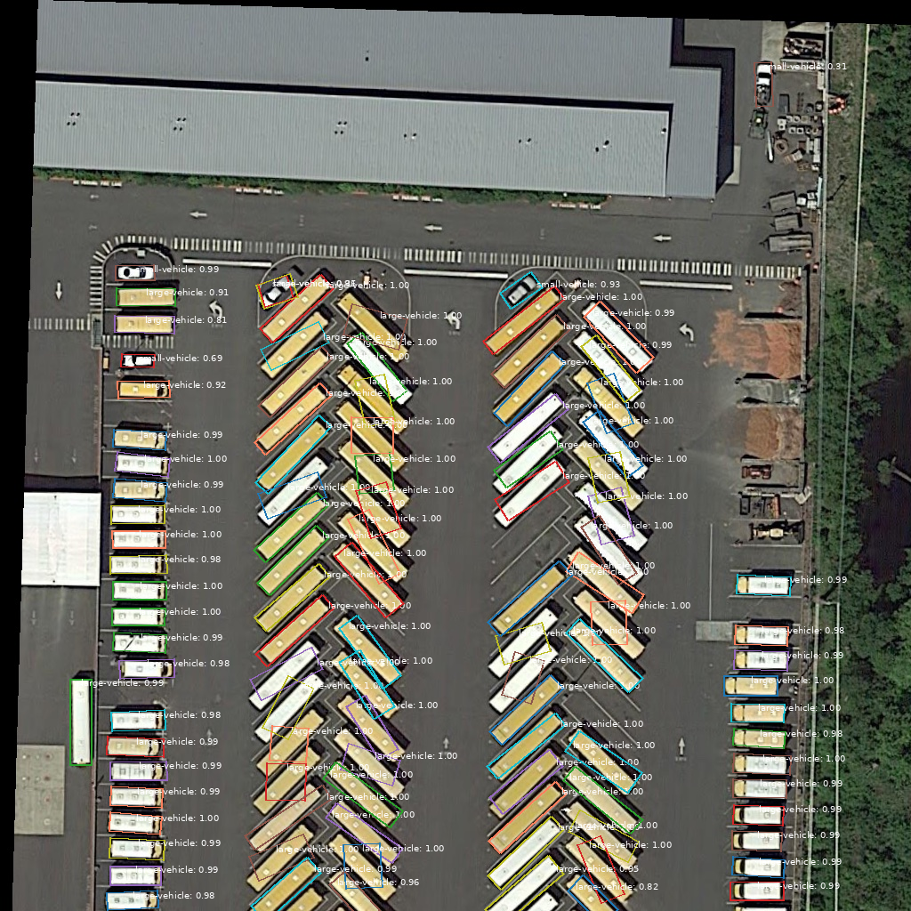

# OrientedDet

**OrientedDet** (**oriented-det**) is an open-source PyTorch framework for **oriented and rotated object detection** in aerial and satellite images. It focuses on clean geometry, reliable operators, simple datasets, and practical baseline models—without the complexity of large detection frameworks.

<p align="center">
  
</p>

<p align="center"><em>Oriented R-CNN on the bundled <code>demo/demo.jpg</code> tile — rotated boxes follow vehicle heading instead of swallowing neighbours in axis-aligned rectangles.</em></p>

**Docs:** [dl4eo.github.io/oriented-det](https://dl4eo.github.io/oriented-det/) · **Blog:** [deeplearning.earth](https://deeplearning.earth) · **Company:** [dl4eo.com](https://dl4eo.com)

## Features

- **Geometry** — Rotated boxes (rbox), quadrilaterals (qbox), polygon conversions, angle conventions (le90), transforms, and visualization helpers
- **IoU & NMS** — Rotated IoU and oriented NMS (CPU; optional GPU kernels when available)
- **Datasets** — DOTA, HRSC2016, FAIR1M, SSDD, and HRSID loaders; tiling; oriented mAP
- **Models** — Oriented R-CNN, Rotated Faster R-CNN, RetinaNet, FCOS, RTMDet, and YOLO-OBB with ResNet-FPN / CSPNeXt / C2f backbones
- **Training** — JSON configs and the **`odet`** CLI (AMP, checkpointing, TensorBoard)
- **Export & Hub** — ONNX export (`odet export`); pretrained weights via Hugging Face Hub

## Installation

From PyPI:

```bash
pip install oriented-det
```

From source (Linux with CUDA 12.1):

```bash
uv venv --python 3.12 && source .venv/bin/activate
uv pip install "torch>=2.4.0" "torchvision>=0.19.0" --index-url https://download.pytorch.org/whl/cu121
uv pip install -r requirements.txt && uv pip install -e .
```

CUDA extras, macOS / CPU, optional dependencies (`[dev]`, `[export]`, `[viewer]`, …), and path placeholders: [Installation](docs/getting-started/installation.md).

## Quick start

```bash
# Inference on the bundled demo image (downloads a Hub checkpoint)
odet image-demo demo/demo.jpg hf://oriented_rcnn_dota_le90_1x --out-file demo/out/result.jpg

# Train on DOTA tiles (edit dataset paths in the config first)
odet train --config configs/oriented_rcnn/dota_le90_1x.json
# Or: make train
```

Demo details: [demo/README.md](demo/README.md) (`make demo` runs all top-level images under `demo/` with the latest local `runs/` checkpoint). Starter recipe: [`configs/oriented_rcnn/dota_le90_1x.json`](configs/oriented_rcnn/dota_le90_1x.json). Walkthrough: [Getting Started](docs/getting-started/installation.md). Config fields: [Configuration](docs/user-guide/configuration.md). Training, tiling, and eval commands: [tools/README.md](tools/README.md#common-commands).

## Learn more

| Audience | Resource |
|----------|----------|
| Users | [Hosted docs](https://dl4eo.github.io/oriented-det/) · [tutorial/](tutorial/) · [demo/](demo/) |
| Model zoo | [configs/](configs/) · [pretrained/](pretrained/) · [eval reports](docs/eval-reports/) |
| Integrators | [export/](export/) · [deploy/](deploy/) · [CLI](oriented_det/cli/) |
| Contributors | [Contributing](docs/contributing.md) · [Roadmap](docs/roadmap.md) · [tests/](tests/) |
| Write-ups | [DeepLearning.Earth](https://deeplearning.earth) (curated index in [docs/README.md](docs/README.md#further-reading)) |

## Repository map

| Path | Role |
|------|------|
| [`oriented_det/`](oriented_det/) | Library (geometry, models, datasets, training, ops) |
| [`oriented_det/cli/`](oriented_det/cli/) | **`odet`** entry point |
| [`tools/`](tools/) | CLI implementations (`odet` / `make`) |
| [`configs/`](configs/) | Experiment JSON and model zoo |
| [`docs/`](docs/) | MkDocs user guide and API reference |
| [`demo/`](demo/), [`tutorial/`](tutorial/) | Examples and learning material |
| [`export/`](export/), [`deploy/`](deploy/) | ONNX export and Docker deploy |
| [`pretrained/`](pretrained/), [`tests/`](tests/) | Hub checkpoints; test suite |

Runs land in `runs/<model_type>/<timestamp>/` (created at train time; not shipped). Prefer **`odet`** or **`make`** after install—both call the same tooling.

## Citation

If you use OrientedDet in research or production, cite this repository via [CITATION.cff](CITATION.cff) ([DOI: 10.5281/zenodo.23273307](https://doi.org/10.5281/zenodo.23273307)).

## License

**Apache-2.0** — Copyright © Jeff Faudi and [DL4EO](https://dl4eo.com). See [LICENSE](LICENSE).

The framework license does not grant rights to the **DOTA** or **HRSC** datasets. See [Apache 2.0 vs DOTA / HRSC dataset terms](https://deeplearning.earth/posts/2026-09-10_oriented_det_apache_license_versus_dota/).

## Acknowledgements

Design and APIs are informed by MMRotate, MMDetection, Detectron2, and related work in oriented object detection; **pretrained checkpoints in `pretrained/` are OrientedDet exports from this codebase**, not MMRotate zoo bundles.

## Consulting

For consulting, training workshops, or custom development, see **[DL4EO](https://dl4eo.com)**.
